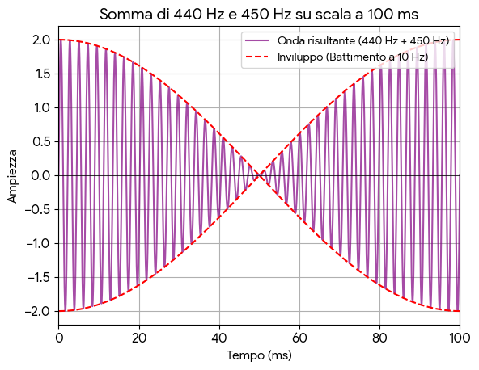
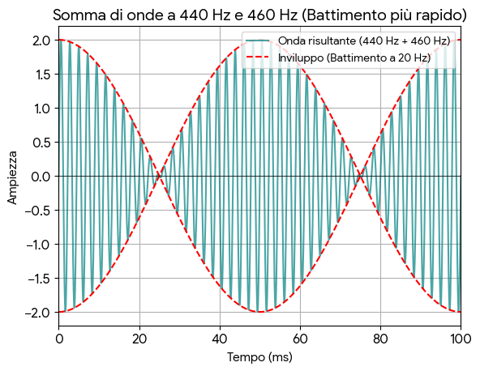

# I battimenti {#sec-battimenti}

Ora che abbiamo capito come funzionano i suoni e in particolare le note che sentiamo con le nostre orecchie siamo pronti per partire alla ricerca dei nostri misteriosi spiritelli. Cominciamo da quelli più facili da individuare: i battimenti. Abbiamo già un primo indizio su dove li potremmo trovare perché abbiamo capito che quando mettiamo diverse note insieme succede qualcosa di particolare. Ad esempio possiamo trasformare un piatto suono elettronico in una brillante nota di pianoforte. Seguiamo quindi questa strada.  

## Da una a due note

Cosa succede quando sovrapponiamo due note a due frequenze diverse? In generale, otteniamo una terza nota, la cui vibrazione è data dalla somma delle vibrazioni delle altre due. Il motivo è legato alla fisica delle onde meccaniche ma anche senza entrare in troppi dettagli possiamo capirlo intuitivamente. Pensiamo di essere al mare e di osservare le onde del mare che arrivano a riva, in una giornata di calma, più o meno tutte uguali. Se improvvisamente passa un motoscafo parallelo alla riva producendo altre onde, quelle del motoscafo andranno a sommarsi alle prime, generando onde che saranno alte come la somma delle due onde. 

Tornando alla musica, questa sovrapposizione può dare origine a risultati molto diversi, a seconda della relazione tra le due note che stiamo sovrapponendo. In particolare, quando le due note che vogliamo sovrapporre sono abbastanza *vicine* ovvero hanno quasi la stessa frequenza, ma non proprio identica, succede che compare come un *trillo* che potremmo identificare anche come un *frrrrr* che è un effetto dovuto proprio alla vicinanza delle frequenze. Sentiamo ad esempio cosa succede sovrapponendo una nota a 440Hz con un'altra a 450Hz:

```{=html}
<audio controls>
  <source src="sounds/440-450.mp3" type="audio/wav">
  Il tuo browser non supporta l'elemento audio.
</audio>
```
Si sente molto bene il *frrrrr* di cui parlavamo che prende il nome, appunto di *battimenti*. 
Se rappresentiamo l'onda risultante dalla somma delle due onde, una a 440 e l'altra a 450 Hz, otteniamo questo:



I battimenti sono un'indicazione che le due note sono molto vicine in termini di frequenza. 
Quanto vicine? Tanto più il trillo è veloce, tanto più le note sono lontane. Tanto più il trillo è lento, tanto più le note sono vicine. Quando le note sono identiche, ovvero quando hanno esattamente la stessa frequenza, i battimenti scompaiono. Proviamo ad esempio ad aumentare la distanza tra le note e prendiamo 440Hz e 460Hz:

```{=html}
<audio controls>
  <source src="sounds/440-460.mp3" type="audio/wav">
  Il tuo browser non supporta l'elemento audio.
</audio>
```
I battimenti in questo caso sono più veloci perché le note sono più lontane. 



Il fenomeno dei battimenti è utilizzato per un duplice scopo. Può essere usato per accordare gli strumenti. Quando stiamo cercando di accordare uno strumento e siamo *vicini* alla nota giusta, i battimenti ci dicono se effettivamente due note sono uguali oppure no. Nell'accordatura della chitarra i battimenti sono molto utilizzati. 

I battimenti possono anche essere utilizzati per creare un effetto di ampiezza del suono. Nella fisarmonica ad esempio, dove il suono viene prodotto dall'aria che passa attraverso delle ance, è possibile abilitare l'apertura contemporanea di più ance diverse, che sono leggermente scordate tra loro. Non troppo da produrre una dissonanza, ma abbastanza da produrre dei battimenti, creando un effetto di maggior movimento del suono. 
