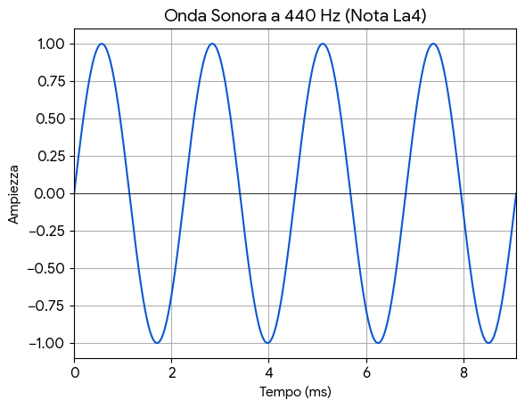
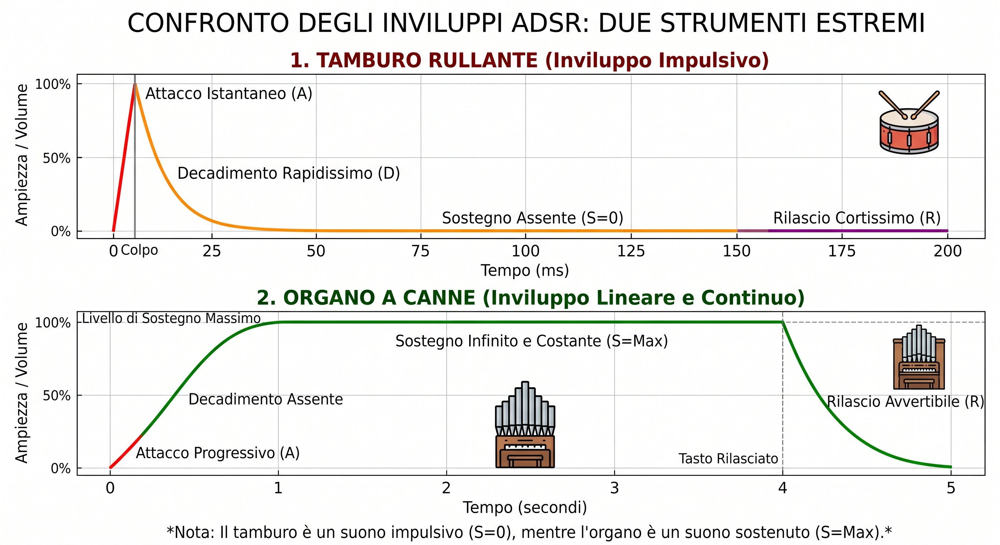

# "Hai sentito quel frrrrr?"

A volte nella musica succedono delle cose strane. Quando un gruppo di musicisti suona insieme, in alcune condizioni succede che si sentano dei suoni che nessuno ha suonato, delle note che appaiono ma fuggevolmente, oppure succede che le note che abbiamo suonato cambino senza che ce ne rendiamo conto. Si tratta di effetti spesso difficili da distinguere chiaramente ma un orecchio esperto non mancherà di notarli quando appaiono e, con grande entusiasmo, ci potrebbe chiedere: "Hai sentito anche tu quel frrrrr, vero?". Le persone non particolarmente allenate all'ascolto della musica (ovvero la maggior parte di noi), in realtà all'inizio farebbe fatica a sentire qualcosa, perché sono effetti che appaiono fuggevolmente e solo in particolari momenti, difficili da sentire. 

Come è possibile, chi è che suona questi suoni misteriosi? Chi è che cambia le note che stiamo suonando? E' come se ci fossero degli spiritelli dispettosi che si divertono a giocare con la nostra musica. Come facciamo a trovarli? Tocca un po' andarli a scovare. Per scovarli meglio, può aiutare la comprensione dell'origine di questi effetti. Proviamo quindi a capire da dove arrivano e come fare a sentirli. 

## Quanti spiritelli ci sono?

Iniziamo con il dire che ci sono vari tipi di spiritelli. Noi ne vedremo tre tipi diversi: i [battimenti](battimenti.qmd), il [*pitch drift*](pitch.qmd) e le [note fantasma](ghost_notes.qmd). In queste pagine cerchiamo di scovare dove si nascondono questi bizzarri folletti. 

## Le vibrazioni delle note {#sec-sinusoide}

Alla base di tutto c'è la natura dei suoni. Tutti i suoni che sentiamo, e quindi anche questi strani spiritelli, sono vibrazioni dell'aria. Il nostro orecchio sente la pressione del'aria sul timpano e trasforma nel nostro cervello questa pressione meccanica nella percezione di un suono. Quando questa pressione si alterna con regolarità e molto velocemente, quando una pressione viene esercitata molte volte in un secondo tramite una vibrazione regolare, sentiamo una nota. Il numero di vibrazioni al secondo si chiama frequenza ed è un numero che identifica ogni nota. Ogni nota che possiamo sentire è quindi associata ad una certa frequenza che corrisponde al numero di vibrazioni al secondo dell'aria contro il timpano del nostro orecchio.

Ad esempio, una vibrazione di 440 volte al secondo corrisponde alla nota La. Il numero di vibrazioni al secondo è misurato in cicli al secondo o Hertz (Hz). Quindi il La è la nota che suona a 440 Hz. Qui sotto è possibile ascoltare il suono di un La a 440 Hz. 

```{=html}
<audio controls>
  <source src="sounds/440.wav" type="audio/wav">
  Il tuo browser non supporta l'elemento audio.
</audio>
```
Se rappresentiamo in un grafico le oscillazioni compiute per generare questo suono otteniamo una curva molto regolare, dove è presente una sola frequenza.



## Più vibrazioni insieme

Non possiamo non notare che questa nota La che abbiamo usato suoni un po' strana. Non sapremmo dire da quale strumento possa essere stato generato. Sembrerebbe più un computer che uno strumento reale. Che cosa ha di particolare questa nota? In realtà quando suoniamo un La con un qualunque strumento compresa la voce, lo strumento non produce mai solo un'unica frequenza. Una nota reale prodotta da uno strumento è un insieme di frequenze mescolate tra loro. Quella che abbiamo sentito prima è una nota *pura* composta da un'unica frequenza. Le note degli strumenti reali invece sono composte da tante frequenze, con dei rapporti precisi tra loro e delle intensistà ben determinate. Per questo riusciamo a distinguere il La di un pianoforte 

```{=html}
<audio controls>
  <source src="sounds/piano440.mp3" type="audio/wav">
  Il tuo browser non supporta l'elemento audio.
</audio>
```
da quello di una chitarra

```{=html}
<audio controls>
  <source src="sounds/chitarra440.mp3" type="audio/wav">
  Il tuo browser non supporta l'elemento audio.
</audio>
```

anche se entrambe le note sono lo stesso La con la stessa frequenza. 

Quindi le note degli strumenti corrispondono a vibrazioni che sono il risultato della composizione di diverse frequenze. E' un po' come dire che il La di un pianoforte, che per il nostro orecchio è una nota singola, in realtà è la composizione di tante (tantissime) note più *piccole* la cui sovrapposizione costituisce quel caratteristico suono che riconosciamo immediatamente. In altre paorle il La del pianoforte e quello della chitarra sono costituiti da tantissime piccole note, diverse tra loro. La principale e più forte è appunto il La a 440Hz, che dà il nome alla nota, ma poi si aggiungo tantissime altre frequenze, diverse tra i due strumenti, che fanno si che distinguiamo chiaramente il suono della chitarra da quello del pianoforte. 

Se rappresentiamo il grafico dell'intensità del suono nel tempo, vediamo che il pianoforte e la chitarra hanno forme molto diverse, più *frastagliate* rispetto alla curva regolare che abbiamo visto prima. 


## Attacco, decadimento, sostegno e rilascio

In realtà dovremmo anche dire che le differenze tra diversi strumenti non sono date solo dalla diversa sovrapposizione delle frequenze che compongono il suono, ma anche da altre caratteristiche. In particolare ci si riferisce comunemente a queste quattro proprietà princiali di un suono: l'**attacco**, il **decadimento**, il **sostegno** e il **rilascio**. Queste proprietà insieme si chiamano *inviluppo*. Vediamo cosa vogliono dire queste proprietà del suono:

* **Attacco**. come il suono di un certo strumento arriva al suo massimo di intensità. 

* **Decadimento**. Dopo aver raggiunto il massimo, il suono inizia a decadere

* **Sostegno**. Dopo il decadimento il suono resta prolungato per un periodo più o meno lungo.  a come resta al livello massimo dopo che è stato suonato
* **Rilascio**. La fase di esaurimento del suono. 

Ogni fase è determinata dalla meccanica di produzione del suono. Ad esempio gli strumenti come il pianoforte hanno un attacco forte, perché il suono è ottenuto dalla percussione del martelletto sulle corde, mentre gli strumenti a fiato avranno, in genere, un attacco più graduale. 

Vediamo qui un diagramma che mostra la differenza tra l'inviluppo di un tamburo e quello di un organo, due strumenti molto diversi per tipologia di suoni prodotti

